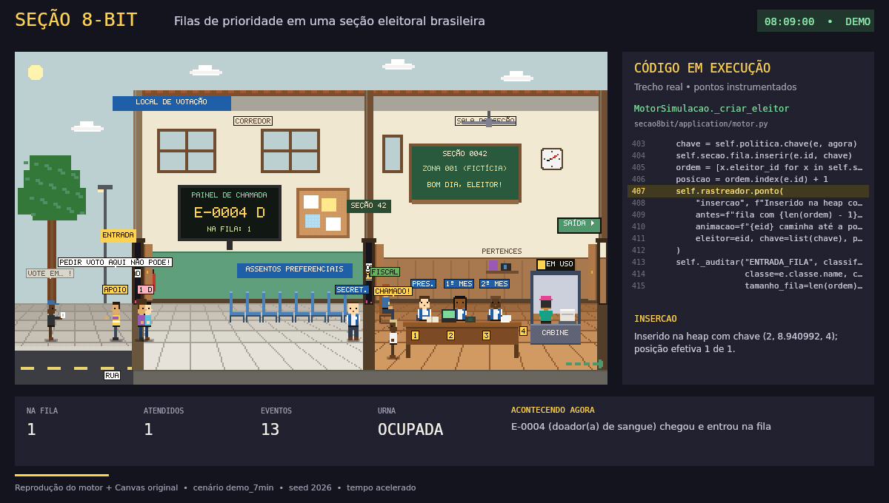

# A3 — Programação de Soluções Computacionais

## SEÇÃO 8-BIT — Simulador de Filas Eleitorais

Simulador acadêmico de **filas de prioridade** ambientado numa seção eleitoral brasileira, com animação
pixel art, exibição do código efetivamente executado, eventos aleatórios, auditoria SQL e comparação de
estratégias contra **starvation**. Trabalho da avaliação A3 de Programação de Soluções Computacionais.

> **Simulação acadêmica sem vínculo oficial com a Justiça Eleitoral.** Personagens e dados fictícios.
> Nenhum CPF, título, biometria ou voto é coletado; nenhuma escolha de voto é modelada ou registrada.


## Demonstração



**A cena e o código, lado a lado:** chegada de eleitores, prioridades, atendimento,
incidentes e acompanhamento das filas.

Reprodução visual em tempo acelerado do motor Python com o **mesmo Canvas do aplicativo**,
cenário `demo_7min`, seed `2026`. O painel exibe trechos reais dos pontos instrumentados;
a composição da prévia não é uma captura da interface Streamlit. Dados fictícios, sem áudio.
O GIF é uma prévia animada; para interagir, siga as instruções de execução abaixo.


## Requisitos

- Python 3.12 ou mais recente (desenvolvido e testado com 3.14.3 no Windows 11)
- Navegador moderno (Chrome, Edge ou Firefox)

## Instalação e execução

```bash
python -m venv .venv
# Windows:
.venv\Scripts\activate
# Linux/macOS:
source .venv/bin/activate

pip install -r requirements.txt        # versões diretas fixadas
# ou, para reproduzir exatamente o ambiente testado:
pip install -r requirements-lock.txt

streamlit run app.py                    # abre em http://localhost:8501
python -m pytest -q                     # roda a suíte de testes
python scripts/gerar_exemplos.py        # regenera sql/logs.sql e imprime a comparação de políticas
```

O banco de auditoria da interface fica em `dados/auditoria.sqlite3` (criado automaticamente).

## Como usar

A interface segue uma sequência didática em quatro visões (botões no topo):

| Visão | Para quê |
|---|---|
| **1 · Entenda a fila** | Fila comum (FIFO) × fila de prioridade com três pessoas, e um laboratório que roda a classe `FilaPrioridade` real: adicione pessoas, chame a próxima e veja o array da heap, a árvore e as posições que mudaram. |
| **2 · Ao vivo** | A seção eleitoral animada. Cartões em linguagem natural dizem quem foi chamado e por quê (ex.: "chegou depois de X, mas tem mais de 80 anos…") e quem é o próximo. Lista de quem espera, legenda permanente e selo **▼ PRÓXIMO** na cena. |
| **3 · Algoritmo** | Chave e política, heap física × ordem de atendimento, agenda de eventos (a outra heap), código em execução com a linha real, complexidades. |
| **4 · Resultados** | Métricas e SLA, starvation e comparação de políticas com a mesma carga, auditoria SQL (hash, exportação, validação) e documentos. Separa regra eleitoral real, hipótese acadêmica e laboratório. |

Controles principais (visões 2 e 3): **▶ Iniciar / ⏸ Pausar**, **⏭ Próxima chamada** (avança até a próxima
pessoa sair da fila e para), **⏭ 1 evento** e **⟳ Recomeçar demo** (`demo_7min`, seed 2026, regras eleitorais).
A barra lateral guarda a velocidade e, recolhidos, *Cenário e política*, *Provocar situações* e *Exibição*.
O **Modo apresentação** (topo, à direita) esconde a barra lateral e põe cena e explicação lado a lado para projetor.
A velocidade muda só o ritmo da tela: para a mesma seed e configuração, os resultados são os mesmos.

Roteiro completo da banca, com os cliques medidos em ensaio: [docs/roteiro_apresentacao.md](docs/roteiro_apresentacao.md).

## Estrutura

```
app.py                      ponto de entrada Streamlit (fino)
secao8bit/domain/           Eleitor, PerfilPrioridade, FilaPrioridade (heap), políticas, recursos, seção
secao8bit/application/      MotorSimulacao, carga reproduzível, agenda/relógio, métricas, rastreamento, cena,
                            explicações em linguagem natural (explicacao.py), laboratório FIFO × heap (didatica.py)
secao8bit/infrastructure/   RepositorioAuditoria (SQLite), exportador de logs.sql
secao8bit/ui/               sessão compartilhada, visões (visoes.py), conteúdo reutilizado (abas.py), componente da cena
assets/cena8bit/            Canvas + JavaScript (só apresentação)
sql/schema.sql, sql/logs.sql
tests/                      pytest (domínio, motor, auditoria, coerência, interface)
docs/                       relatório, regras, UML, dicionário, requisitos, testes, roteiro
```

## Documentação

- [Relatório técnico](docs/relatorio_tecnico.md)
- [Regras eleitorais e rastreabilidade](docs/regras_eleitorais.md)
- [Matriz de requisitos do enunciado](docs/matriz_requisitos.md)
- [Eventos e incidentes](docs/eventos.md)
- [UML e dicionário de classes](docs/dicionario_e_uml.md)
- [Testes e evidências](docs/testes.md)
- [Roteiro da apresentação (20 min)](docs/roteiro_apresentacao.md)
- [Ferramentas usadas no desenvolvimento](docs/ferramentas.md)

## Versionamento

O repositório está publicado no GitHub, na branch `main`, com histórico de commits.
O enunciado pede contribuições reais distribuídas entre os integrantes. Por isso, cada pessoa deve commitar a área que estudou e consegue explicar
na arguição (a divisão sugerida está em `docs/roteiro_apresentacao.md`). Exemplo:

```bash
git add secao8bit/domain/prioridade.py tests/test_prioridade.py docs/regras_eleitorais.md
git commit -m "Classificação de prioridade conforme art. 129 da Res. 23.751/2026"

git pull origin main   # o repositório já está no GitHub
git push origin main
```

`.venv/`, `dados/` (banco local) e `exports/` ficam fora do controle de versão (`.gitignore`).

