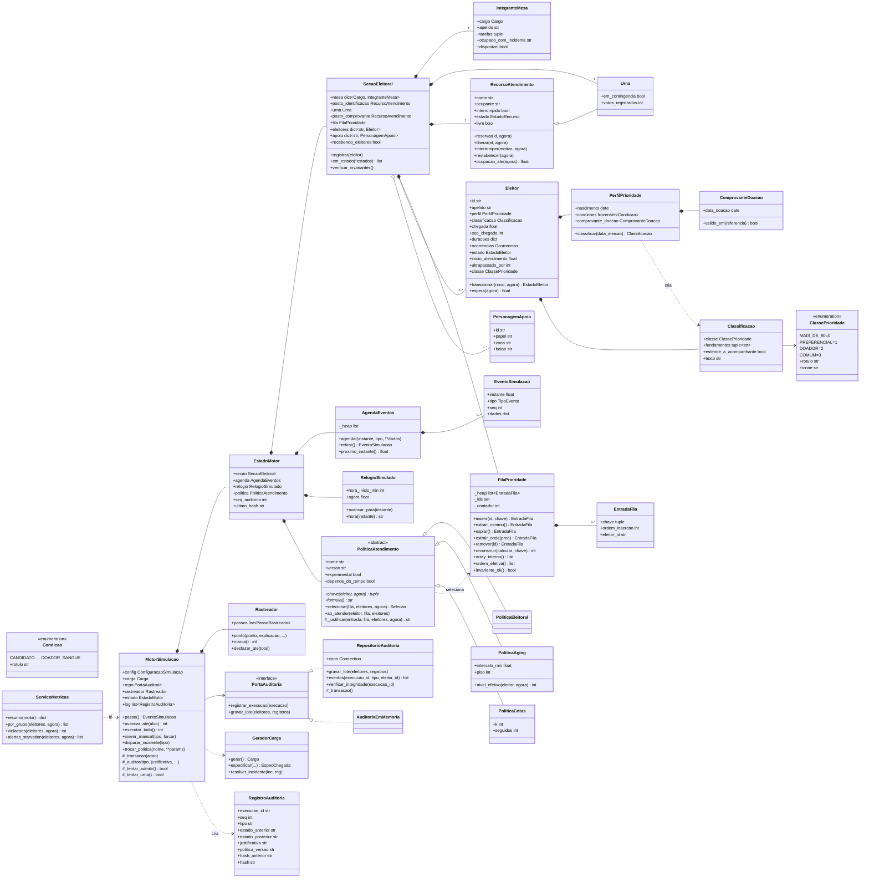

# UML e dicionário de classes, métodos e estruturas

Convenção de visibilidade em Python: `+` público, `#` protegido (prefixo `_`, uso interno da classe e das
subclasses), `-` privado (detalhe de implementação). O diagrama usa Mermaid (o GitHub renderiza diretamente).

## Dicionário

### Domínio (`secao8bit/domain`)

| Classe / função | Responsabilidade | Métodos principais |
|---|---|---|
| `Condicao` (Enum) | Incisos do art. 129, § 2º (exceto idade, que é derivada) | `rotulo` |
| `ClassePrioridade` (IntEnum) | Classe de atendimento; o valor menor é atendido antes | `rotulo`, `icone` |
| `tem_mais_de` / `tem_ao_menos` | Comparação etária literal ("mais de" é estrita; "igual ou superior" inclui o dia) | — |
| `ComprovanteDoacao` | Valida o comprovante de doação (≤ 120 dias) | `valido_em` |
| `PerfilPrioridade` | Composição das condições de uma pessoa | `classificar(data)` → `Classificacao` |
| `Classificacao` | Resultado imutável: classe, fundamentos, extensão ao acompanhante | `texto` |
| `Eleitor` | Pessoa fictícia; máquina de estados validada (`TRANSICOES_VALIDAS`) | `transicionar`, `espera` |
| `FilaPrioridade` | Heap mínima encapsulada (`heapq`) | `inserir`, `extrair_minimo`, `reconstruir`, `ordem_efetiva`, `array_interno` |
| `PoliticaAtendimento` (ABC) | Contrato das políticas: chave, fórmula, seleção | `chave`, `selecionar`, `ao_atender` |
| `PoliticaEleitoral` / `PoliticaAging` / `PoliticaCotas` | Ver relatório, seção 5 | — |
| `RecursoAtendimento` | Recurso de capacidade 1 com invariantes e contabilidade de tempo | `reservar`, `liberar`, `interromper`, `restabelecer` |
| `Urna` | Recurso exclusivo de votação; conta votos (sem escolha) | — |
| `IntegranteMesa` / `Cargo` | Integrante da mesa e suas tarefas didáticas | `disponivel` |
| `SecaoEleitoral` | Agrega mesa, postos, urna, fila e pessoas; verifica invariantes | `verificar_invariantes` |

### Aplicação (`secao8bit/application`)

| Classe | Responsabilidade |
|---|---|
| `ConfiguracaoSimulacao`, `CENARIOS` | Parâmetros imutáveis; 7 cenários reproduzíveis |
| `GeradorCarga`, `Carga`, `EspecChegada` | Carga prévia com fluxos aleatórios separados (chegadas, perfis, durações, incidentes) |
| `AgendaEventos`, `EventoSimulacao`, `TipoEvento` | Heap de eventos futuros (instante, prioridade do tipo, seq) |
| `RelogioSimulado` | Tempo simulado, que nunca volta |
| `MotorSimulacao`, `EstadoMotor` | Processa eventos, aplica a política na admissão, trata incidentes, audita em transação com rollback |
| `Rastreador`, `PassoRastreado`, `ReferenciaCodigo` | Pontos instrumentados com arquivo, método e linha reais |
| `ServicoMetricas`, `Estatistica` | Esperas (com censura), SLA, starvation, ocupação, vazão |
| `RegistroAuditoria`, `calcular_hash`, `verificar_cadeia` | Registro imutável e hash encadeado |
| `montar_cena` | Converte o estado em zonas e vagas para o Canvas (sem lógica de negócio) |
| `comparar` | Roda variantes de política com a mesma carga |

### Infraestrutura (`secao8bit/infrastructure`)

| Classe / função | Responsabilidade |
|---|---|
| `RepositorioAuditoria` | SQLite, FKs ligadas, consultas parametrizadas, `BEGIN IMMEDIATE`/`COMMIT`/`ROLLBACK` |
| `exportar_logs`, `literal_sql` | Gera o `logs.sql` executável com escaping |
| `validar_importacao` | Importa schema + logs num banco vazio e compara linha a linha |

### Estruturas de dados

| Estrutura | Onde | Por quê |
|---|---|---|
| Heap binária (lista + `heapq`) | `FilaPrioridade`, `AgendaEventos` | O(log n) para inserir e extrair o mínimo |
| Tupla como chave | políticas | Comparação lexicográfica = critério + desempate estável |
| Dicionário id → objeto | `SecaoEleitoral.eleitores` | Acesso O(1) para a heap guardar só IDs |
| Conjunto | `FilaPrioridade._ids` | `in` em O(1) e detecção de duplicados |
| Lista FIFO | `aguardando_comprovante` | Pós-voto, sem prioridade |
| Lista encadeada por hash | `evento_auditoria.hash_anterior` | Detecção de adulteração |

### Projeção e troca de política

- `MotorSimulacao.prever_atendimento() -> list[EntradaFila]`: projeta a ordem
  no instante atual sobre cópias da heap e da política. Considera cotas e
  recalcula aging, sem alterar o motor, logs ou rastreamento. A projeção não
  antecipa chegadas nem envelhecimento futuro; pode mudar com o tempo.
  Custo O(n log n) nas políticas eleitoral/aging e O(n²) no pior caso de cotas.
- `MotorSimulacao.trocar_politica(nome, **params)`: sincroniza a configuração
  somente depois de a transação de auditoria ter sucesso.
- `SessaoSimulacao.trocar_politica(nome, **params) -> bool`: sincroniza a
  configuração da sessão e informa sucesso à interface. Em falha, pausa e
  mantém a configuração anterior; não exibe confirmação de gravação.
